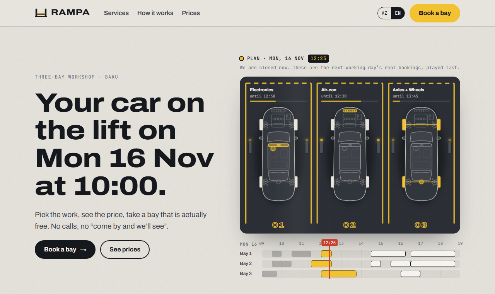
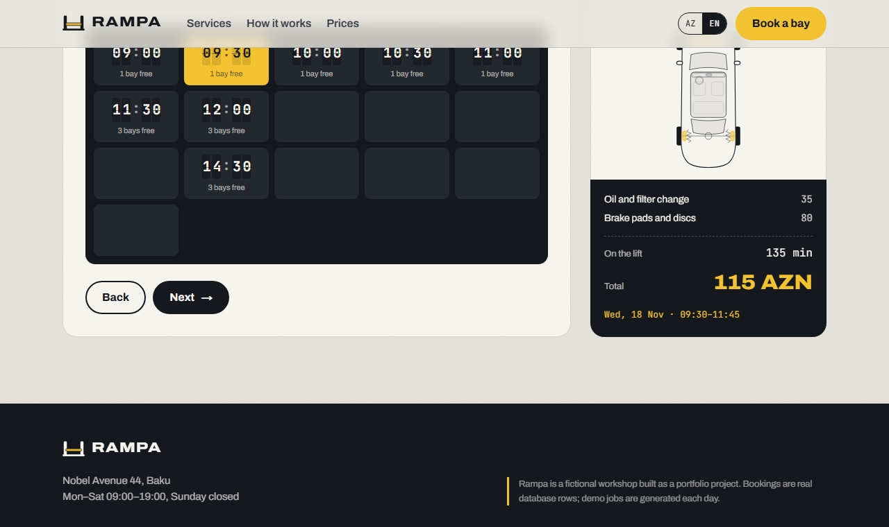
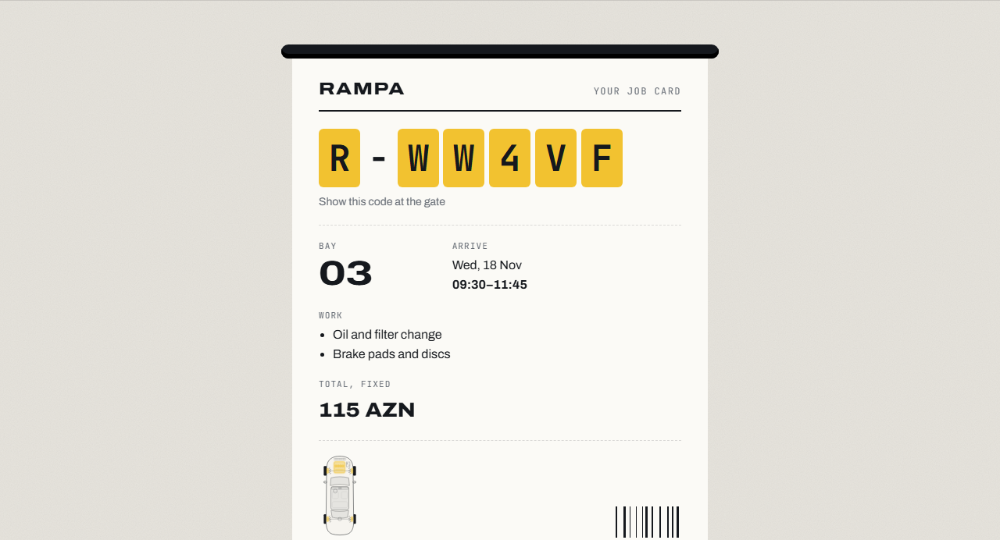
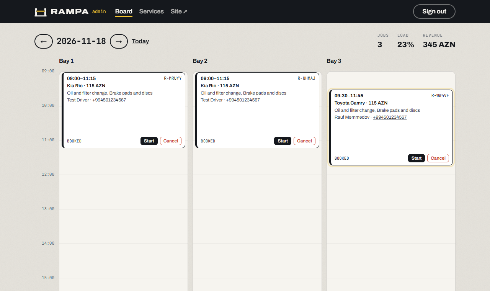

# Rampa — online booking for a three-bay car workshop

Rampa is a fictional car workshop in Baku. This repository is its website and booking
system: visitors pick the work, see a fixed price, and take a time when a lift is really
free. The workshop sees every booking on an admin board.



## What it does

- **Live floor.** The home page shows the three lifts as a top-down drawing. Which car is on
  which lift, and which part is being worked on, is computed from real bookings and the
  clock. The page updates itself every minute. When the workshop is closed, it plays the
  next working day's bookings fast instead.
- **Booking in four steps.** Work → day → time → contact details. Times come from an API
  that only returns slots where at least one bay is free for the whole job.
- **No double bookings, guaranteed by the database.** A Postgres `EXCLUDE` constraint
  refuses two live bookings whose time ranges overlap on the same bay. Two people clicking
  the same slot at the same moment cannot both get it; the loser is moved to the next free
  bay or told the time is gone.
- **Job card.** After booking, a printable card with a code, bay, time, work and total, plus
  an `.ics` file for the phone's calendar.
- **Admin board.** One column per bay on a 09:00–19:00 axis; start, finish or cancel a job;
  edit prices and durations. A price change reaches the public price list at once.
- **Telegram notification** to the owner for every new booking (optional).
- **Two languages**: Azerbaijani and English, chosen from the browser on first visit.

| Booking | Job card | Admin board |
| --- | --- | --- |
|  |  |  |

## Stack

- **Next.js 16** (App Router, Cache Components / Partial Prerendering, Server Actions,
  Route Handlers, `proxy.ts`), **React 19**, **TypeScript**
- **PostgreSQL**: Neon in production; [PGlite](https://pglite.dev) (Postgres compiled to
  WebAssembly) for local development and tests, so the project runs with zero setup
- Plain SQL through a small adapter (no ORM), **Zod** for input validation
- **Motion** for animation, CSS Modules for styling, hand-drawn SVG
- **jose** (signed JWT session cookie) for the admin login
- **Vitest** (unit and database tests), a Playwright end-to-end script, GitHub Actions CI

## How the pieces fit

```
src/
  app/
    [locale]/            public pages, prerendered for az and en
      page.tsx           home: static shell + streamed live floor
      book/              booking wizard page + bookAction (Server Action)
      booking/[code]/    job card
    admin/               second root layout: login, board, services
    api/
      availability/      GET free times for a day and a set of jobs
      bookings/[code]/ics  calendar file
      cron/demo/         daily job that keeps the demo floor busy
  proxy.ts               / -> /az or /en, quick session check for /admin
  lib/
    schedule.ts          pure scheduling rules (opening hours, slots, overlaps)
    bookings.ts          SQL: read a day, create a booking, admin updates
    db.ts                Postgres adapter: postgres.js or PGlite
    queries.ts           data for pages: cached price list, per-request live data
    auth.ts              admin session
db/migrations/           schema and price list
tests/                   Vitest
```

A few decisions worth knowing:

- **Rendering.** The price list is cached with `"use cache"` and becomes part of the static
  page; editing a price calls `updateTag("services")`. Everything that depends on the
  current time (the next free slot in the headline, the live floor) is read per request
  inside `<Suspense>` and streams in after the static shell.
- **Two checks for a booking.** The app first checks the slot against existing bookings,
  then inserts; the `EXCLUDE` constraint is the real guarantee if two requests race between
  those steps. Booking and its services are inserted in one SQL statement, so a booking
  without services cannot exist.
- **Admin access.** `proxy.ts` redirects visitors without a valid session cookie, but every
  admin page and Server Action checks the session again: a Server Action is a public POST
  endpoint, and the proxy is only a first filter.
- **Privacy.** The public floor receives only bay, time and parts, never names, phones or
  cars.

## Run it

Requires Node.js 20.9+.

```bash
npm install
npm run dev          # http://localhost:3000, data in .data/pglite
```

Admin: `/admin`, password `rampa-demo` (public demo; set `ADMIN_PASSWORD` to change it).

```bash
npm test             # unit + database tests (in-memory Postgres)
npm run lint
npm run typecheck
npm run build
node tools/e2e.mjs http://localhost:3000   # browser test; set CHROME_PATH to a Chromium
```

## Deploy

1. Create a Postgres database (Neon free tier works) and run
   `DATABASE_URL=... npm run db:migrate`.
2. Import the repository on Vercel and set `DATABASE_URL`, `SESSION_SECRET`, `CRON_SECRET`
   and `SITE_URL` (see `.env.example`). `vercel.json` schedules the daily demo job.

## License

MIT. Rampa, its address and its bookings are fictional.
